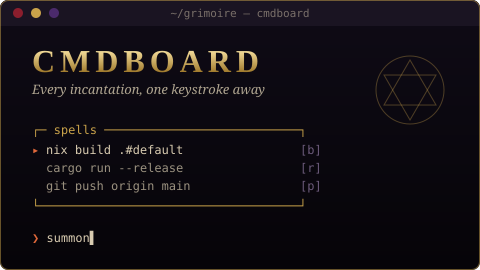

  

  

  

<h2 align="center">📜 The Chronicle</h2>

  <i>« Hi, I'm Loris — a developer who prefers building the forge to buying the sword. »</i>

  🗡️ Building games on <b>homemade engines</b> &nbsp;·&nbsp;
  👾 Emulating ancient machines &nbsp;·&nbsp;
  🐧 Learning <b>Linux</b> &nbsp;·&nbsp;
  ❄️ Quest: <b>NixOS</b>

<h2 align="center">⚔️ Featured Quests</h2>

<table align="center">
  <tr>
    <td width="50%">
      
    </td>
    <td width="50%">
      <h3><a href="https://github.com/Loris01100/Lanista">Lanista</a></h3>
      
A gladiator game running on a <b>homemade engine written in Rust</b>. Train your fighters, send them to the arena, and pray they come back.

      
      
      
    </td>
  </tr>
  <tr>
    <td width="50%">
      
    </td>
    <td width="50%">
      <h3><a href="https://github.com/Loris01100/Zigboy">Zigboy</a></h3>
      
A <b>Game Boy emulator</b> written in Zig — CPU, PPU and memory banks brought back from the dead, one opcode at a time.

      
      
      
    </td>
  </tr>
  <tr>
    <td width="50%">
      
    </td>
    <td width="50%">
      <h3><a href="https://github.com/Loris01100/CmdBoard">CmdBoard</a></h3>
      
A terminal command board in Rust — keep your most-used incantations at hand and cast them with a single key.

      
      
      
    </td>
  </tr>
</table>

<a href="https://github.com/Loris01100?tab=repositories"><b>✦ Explore the whole archive ✦</b></a>

<h2 align="center">🔮 Arsenal</h2>

  

<h2 align="center">🩸 Battle Records</h2>

  

  

  <i>ᛚᛟᚱᛁᛊ · “The forge is never cold.”</i>

